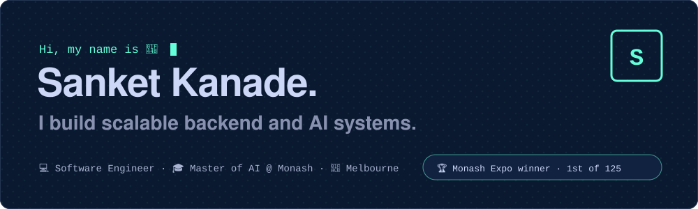
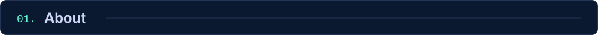
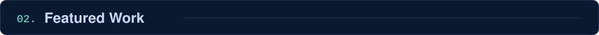
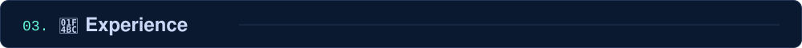
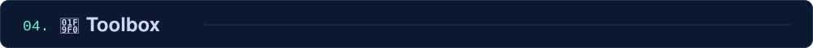

  

  
  
  

👋 Software engineer finishing a Master of Artificial Intelligence at Monash University, Melbourne (Nov 2026). I build backend systems and applied ML: payment batch jobs in production at Mindgate Solutions, and most recently the language-model pipeline behind **BetweenWords**.

> 🏆 **Winner, Monash Final Year Industry Project Expo** · Semester 2, 2026 · first among 125 teams, with BetweenWords

`Featured Project · 2026`
#### 💬 [BetweenWords](https://github.com/TA-35/TheSignalBridge) · [live app ↗](https://thesignalbridge.com)
Accessible full-stack web app with a fine-tuned small language model and a verified message-reading pipeline. Top contributor, with 47 merged pull requests.

▹ Fine-tuned Qwen3.5-4B with LoRA and served it as a 4-bit GGUF model with llama.cpp: entity recall 91% → 98%, meaning preserved 86% → 96% on a locked 180-message test set. 
▹ Rebuilt the reading pipeline on GPT-OSS-120B with quote and entity checks and a self-repair loop: verified answers 68% → 100%, median latency 15 s → 2 s, under \$0.001 per message.

`Featured Project · 2026`
#### 🎬 [MovieLens recommender](https://github.com/sanketkanade/movielens-recsys)
Top-10 recommenders on MovieLens-1M: popularity, item-kNN, NumPy ALS and a scikit-learn GBM re-ranker on a temporal split. Reproducible with Docker.

`Featured Project · 2025`
#### 🐦 [BirdTag](https://github.com/sanketkanade/BirdTag)
Serverless AWS media storage with ML species detection, automated tagging, multi-tag search and real-time notifications, behind fine-grained IAM access control.

`Built at UniHack`
#### 🤝 [Kinship](https://github.com/sanketkanade/UniHack_project)
Full-stack community platform: tag extraction, matchmaking and a map of nearby connections.

💼 **Software Engineer, Mindgate Solutions** · `Aug 2023 – Nov 2024` 
▹ Payment batch jobs handling millions of transactions daily: processing time down 25% at 99.99% uptime. 
▹ Spring Security role-based access control and SAML SSO, cutting login-related tickets by 30%.

🔬 **Winter Vacation Researcher, Monash University** · `Jun – Jul 2025` 
▹ Python ETL pipeline linking historical Tasmanian street directory records, with matching that cut false matches by 30%.

| Area | Stack |
|:--|:--|
| 💻 **Languages** | 🐍 Python · ☕ Java · ⚙️ C++ · 🟦 TypeScript · 🗄️ SQL |
| 🧠 **ML** | 🔥 PyTorch · 🤗 Hugging Face · 🦙 llama.cpp · 🧩 LoRA · 💫 spaCy · 📚 RAG |
| 🛠️ **Back end** | 🍃 Spring Boot · 🔐 Spring Security · 🧪 Flask · ⚡ FastAPI · 🟢 Node.js |
| ☁️ **Cloud & DevOps** | 🟧 AWS · 🔷 Azure · 🐳 Docker · 🔁 GitHub Actions · 🐧 Linux |

Styled to match <a href="https://sanketkande.vercel.app">my portfolio</a> · navy <code>#0a192f</code> and cyan <code>#64ffda</code>

